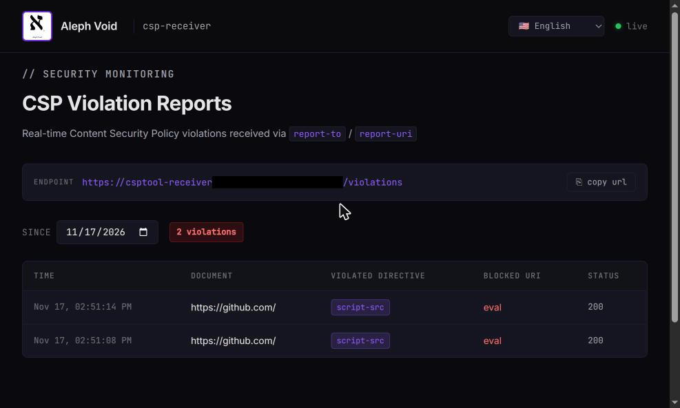

# CSP Violation Receiver

[](https://github.com/sponsors/aleph-void)

An Express 5 web application that receives, persists, and visualises Content Security Policy violation reports in real time. Built for [Aleph Void, LLC](https://alephvoid.com).

## Dashboard



Filter reports by date, copy the reporting endpoint, and select a violation to inspect its policy, source location, and raw report JSON. The dashboard offers 13 interface languages and updates through Socket.io as reports arrive. The screenshot has its receiver hostname redacted.

## Features

- **POST `/violations`** — accepts reports from both the legacy `report-uri` directive (`application/csp-report`) and the modern Reporting API `report-to` directive (`application/reports+json`)
- **GET `/violations`** — returns all violations since a given date (defaults to today) as JSON
- **Dashboard at `/`** — Vue 3 single-page app styled to match alephvoid.com; displays violations in real time via Socket.io
- **SQLite persistence** via `better-sqlite3` (WAL mode, zero external dependencies)
- **Socket.io** — pushes new violations to all connected dashboard clients the moment they are received

Requires Node 24 or Node 26 (Node 24 is the default). After switching Node versions, run `npm ci` again to install the matching native SQLite binary.

## Quick start

```bash
nvm use
npm ci
npm start
```

The server listens on port `3000` by default. Open `http://localhost:3000` to view the dashboard.

### Environment variables

| Variable | Default | Description |
|----------|---------|-------------|
| `PORT` | `3000` | HTTP port to listen on |
| `HOST` | `0.0.0.0` | Bind address; installer sets `127.0.0.1` behind nginx |
| `DB_PATH` | `./violations.db` | Path to the SQLite database file |

## Ubuntu 26 server installer

From a checkout on an Ubuntu 26.x server using systemd (amd64 or arm64):

```bash
sudo ./install.sh reports.example.com
```

This reuses a matching certificate in `/etc/letsencrypt/live/`. The exact hostname's lineage is preferred, then other lineages are checked for a matching SAN, including wildcard certificates. Use `--cert-name example.com-0001` to select one explicitly. An expired matching certificate is renewed with its existing Certbot renewal configuration before use. Certificates must cover the hostname and match the private key. No self-signed fallback is installed.

If there is no certificate yet, create a Cloudflare credentials file and supply an ACME email address:

```bash
sudo install -d -m 700 /root/.secrets/certbot
sudoedit /root/.secrets/certbot/cloudflare.ini
sudo chmod 600 /root/.secrets/certbot/cloudflare.ini
```

The file contains a Cloudflare API token with **Zone / DNS / Edit** access scoped to the relevant zone:

```ini
dns_cloudflare_api_token = YOUR_CLOUDFLARE_API_TOKEN
```

Then run:

```bash
sudo ./install.sh reports.example.com \
  --email admin@example.com \
  --cloudflare-credentials /root/.secrets/certbot/cloudflare.ini
```

New issuance uses Certbot's Cloudflare DNS-01 plugin and accepts the Let's Encrypt subscriber agreement. The credentials are copied to `/etc/letsencrypt/csptool-receiver/cloudflare.ini` with root-only permissions so renewals do not depend on your checkout or login account. Existing certificate reuse does not require a new credentials file. The default input credential path is `/etc/letsencrypt/cloudflare.ini`.

The installer:

- Installs nginx, Certbot, the Cloudflare plugin, and native build prerequisites through apt.
- Downloads a dedicated official Node 24 runtime and verifies its published SHA-256 checksum. Ubuntu 26.04's stock Node 22 is not used or replaced. Choose `--node-major 26` if desired.
- Installs production dependencies as the unprivileged `csptool-receiver` user and makes the application release root-owned afterward.
- Runs the receiver as a boot-enabled systemd service, listening only on `127.0.0.1:3000`. Use `--port 3456` to select another backend port.
- Configures nginx on ports 80/443, redirects HTTP to HTTPS with status 308, and proxies the dashboard, report API, and Socket.io WebSockets.
- Enables `certbot.timer` and installs a deploy hook that validates and reloads nginx after renewal. Existing Certbot authentication settings are preserved for reused lineages.
- Validates nginx and checks backend and HTTPS health before reporting success. Failures during activation restore the previous app link and managed configuration; packages, certificates, and staged releases are not removed.

Point the hostname's DNS at the server and allow inbound TCP ports 80 and 443 in your firewall. The script does not modify DNS address records or firewall rules. For a Cloudflare-proxied hostname, use Full (strict) TLS; DNS-01 issuance does not require disabling the proxy. The dashboard and GET API have no built-in authentication, so apply your own access controls if reports should not be public.

### Updating and operating the installed service

Pull the desired revision in your checkout and rerun the same command. The installer manages one receiver instance per server and refuses to overwrite unmarked service/nginx files. Other nginx sites are left in place. Application releases are retained under `/opt/csptool-receiver/releases`; `current` points to the active release. SQLite data lives separately at `/var/lib/csptool-receiver/violations.db` and is preserved across upgrades. An existing database in the source checkout is **not** imported automatically.

```bash
./install.sh reports.example.com --dry-run
sudo systemctl status csptool-receiver nginx certbot.timer
sudo journalctl -u csptool-receiver -f
sudo certbot renew --dry-run
```

Back up the SQLite database using SQLite's backup API, or stop the receiver before copying the database and any WAL files. Service configuration is in `/etc/csptool-receiver/receiver.env`; rerunning the installer regenerates it from the selected options. nginx configuration is in `/etc/nginx/sites-available/csptool-receiver`. Certbot certificates stay at their original paths, so nginx sees renewed files through Certbot's normal symlinks.

### Installer validation

```bash
npm test -- --runInBand
docker build -f tests/deployment/Dockerfile -t receiver-installer-test .
docker run --rm -v "$PWD:/source:ro" receiver-installer-test
```

The smoke test runs in a disposable Ubuntu 26.04 container with real nginx, Node, SQLite, HTTPS, and WebSocket requests. It tests certificate reuse, upgrades with retained data, configuration rollback, and the Cloudflare issuance/renewal-hook path. Certbot issuance and systemd lifecycle commands are simulated; no real Cloudflare credentials or ACME account are used, and host configuration is not modified. The generated service unit is checked with `systemd-analyze verify`. Live ACME issuance and boot-time systemd behavior still require verification on the target server.

## CSP configuration

### Modern Reporting API (`report-to`)

```http
Content-Security-Policy: default-src 'self'; report-to csp-endpoint
Reporting-Endpoints: csp-endpoint="https://your-host/violations"
```

### Legacy `report-uri`

```http
Content-Security-Policy: default-src 'self'; report-uri https://your-host/violations
```

## API

### `POST /violations`

Accepts `application/csp-report` or `application/reports+json` bodies. Returns `204 No Content` on success.

### `GET /violations?since=YYYY-MM-DD`

Returns a JSON array of violation objects ordered by `received_at` descending.

```bash
# All violations since a specific date
curl http://localhost:3000/violations?since=2026-04-01

# Today's violations (default)
curl http://localhost:3000/violations
```

**Violation object fields:**

| Field | Type | Description |
|-------|------|-------------|
| `id` | integer | Auto-increment primary key |
| `received_at` | string (ISO 8601) | When the report was received |
| `document_uri` | string \| null | Page that had the violation |
| `violated_directive` | string \| null | The directive that was violated |
| `effective_directive` | string \| null | The effective directive |
| `blocked_uri` | string \| null | The resource that was blocked |
| `original_policy` | string \| null | The full CSP header value |
| `referrer` | string \| null | Referrer of the page |
| `status_code` | integer \| null | HTTP status of the page |
| `source_file` | string \| null | Source file of the violation |
| `line_number` | integer \| null | Line number |
| `column_number` | integer \| null | Column number |
| `raw` | string | Raw JSON of the original report body |

## Running tests

```bash
npm test
```

Tests cover:

- **`tests/db.test.js`** — SQLite layer: insert, query, ordering, isolation
- **`tests/app.test.js`** — HTTP routes: both report formats, field normalisation, Socket.io emit hook, GET filtering
- **`tests/socket.test.js`** — Socket.io: initial payload on connect, real-time `violation` events, multiple concurrent clients

## Docker

### Build and run

```bash
docker build -t csptool-receiver .
docker run -p 3000:3000 -v $(pwd)/data:/app/data \
  -e DB_PATH=/app/data/violations.db \
  csptool-receiver
```

### Docker Compose (recommended for production)

```yaml
services:
  csptool:
    build: .
    ports:
      - "3000:3000"
    volumes:
      - ./data:/app/data
    environment:
      DB_PATH: /app/data/violations.db
    restart: unless-stopped
```

```bash
docker compose up -d
```

## CI / GitHub Actions

The workflow at `.github/workflows/ci.yml` runs on every pull request and push to `main`:

1. Runs the test suite against Node.js 24 and 26
2. Builds the Docker image to verify the `Dockerfile` is valid

The test matrix also runs for Dependabot pull requests. CI uses a read-only token, bounded job timeouts, and cancels superseded runs on the same branch. These workflow checks do not themselves enforce branch protection; configure required status checks in repository rules if merges must be blocked on failures.

### Security automation

- `.github/dependabot.yml` checks npm dependencies, Docker images, and GitHub Actions weekly. npm minor/patch updates and Action updates are grouped to reduce PR noise; npm major updates remain separate. Dependabot does not auto-merge updates.
- `.github/workflows/codeql.yml` scans JavaScript/TypeScript and GitHub Actions on pull requests, pushes to `main`, weekly, and manual dispatch. It uses CodeQL's no-build mode and does not execute application dependency install scripts.
- CodeQL has an explicit public-repository guard. While this repository is private, the analysis jobs are skipped; making it public enables the workflow without a paid Code Security subscription. To run CodeQL while private, an administrator must separately enable GitHub Code Security and deliberately adjust this guard.
- Dependabot version updates start when the configuration reaches the default branch. Dependabot alerts and automated security updates are separate repository settings.

Standard hosted Actions runners and CodeQL are free for public repositories. Private-repository CI consumes the account's included Actions usage and may incur overage charges. Dependabot is available for both public and private repositories. See [GitHub Actions billing](https://docs.github.com/en/billing/concepts/product-billing/github-actions) and [CodeQL availability](https://docs.github.com/en/code-security/concepts/code-scanning/codeql/codeql-code-scanning).

## Project structure

```
csptool-receiver/
├── src/
│   ├── app.js          # Express app factory (routes, middleware)
│   ├── db.js           # SQLite wrapper (createDb)
│   └── public/
│       └── index.html  # Vue 3 dashboard (CDN, no build step)
├── tests/
│   ├── app.test.js
│   ├── db.test.js
│   └── socket.test.js
├── server.js           # Entry point — wires HTTP server + Socket.io
├── Dockerfile
└── .github/workflows/ci.yml
```

## Use with CSP Tool

With sibling checkouts of `csptool` and `csptool-receiver`:

1. Start this receiver with `npm start` and open `http://localhost:3000`.
2. Open the target page and the CSP Tool popup. Add `report-uri` with the value `http://localhost:3000/violations` to the policy being tested.
3. Disable any existing `report-to` directive when using this local legacy setup. Supporting browsers prefer `report-to` and may ignore `report-uri` even when the reporting group is not configured.
4. Click Apply and exercise the page. Browser-generated reports appear in this dashboard and are persisted in SQLite.

Use a reachable HTTPS receiver for remote or HTTPS deployments. `localhost` always means the browser user's machine. The modern `report-to` flow requires the tested site's `Reporting-Endpoints` header naming an HTTPS endpoint, as shown above; a group name in CSP alone is insufficient. Reporting API delivery may be batched. The extension's Errors tab also shows DOM violation events; these are distinct from successful delivery of HTTP reports.

To verify the integration, install both projects' dependencies using the same Node version, then run from the `csptool` directory:

```bash
npm run test:receiver
```

That suite starts an isolated receiver with a temporary SQLite database, applies CSP through the built extension, checks a real browser report, verifies Socket.io delivery and persisted rows, and checks the modern report payload contract. It does not touch your running receiver or `violations.db`. Set `CSP_RECEIVER_DIR` if the receiver checkout is elsewhere.
